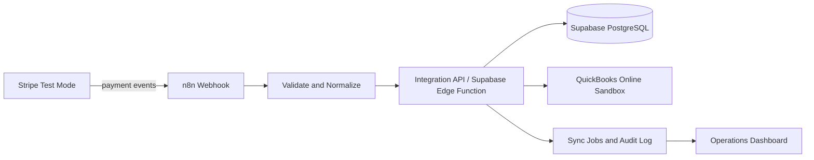

# Finance Operations Integration Hub

A sandbox finance automation project integrating **Stripe**, **QuickBooks Online**, **Supabase/PostgreSQL**, and **n8n**. It demonstrates how payment events can be validated, recorded, reconciled, and synchronized with accounting systems through observable, retry-safe workflows.

> **Status:** Architecture and foundation stage. This repository is a portfolio/demo project, not production financial software. Use Stripe test mode, QuickBooks Sandbox, synthetic customer data, and non-production Supabase projects only.

## What this project demonstrates

- Event-driven payment processing from Stripe webhooks
- Reliable payment-to-accounting synchronization with QuickBooks Online
- PostgreSQL data modeling for customers, payments, invoices, sync jobs, and audit events
- n8n orchestration with explicit error handling and operational visibility
- Idempotency, retry safety, and reconciliation patterns
- Secure handling of API credentials and environment configuration

## Architecture



See [Architecture](docs/architecture.md) and [Data Model](docs/data-model.md).

## Repository structure

```text
.
├── docs/
│   ├── architecture.md
│   └── data-model.md
├── n8n/
│   └── workflows/
│       └── stripe-payment-ingestion.json
├── supabase/
│   └── migrations/
│       └── 001_initial_schema.sql
├── .env.example
└── README.md
```

## Quick start

1. Create separate **Stripe test mode**, **QuickBooks Sandbox**, and **Supabase development** resources.
2. Copy `.env.example` to `.env` and fill in local development values. Never commit real credentials.
3. Apply the SQL migration in `supabase/migrations/001_initial_schema.sql` to your development database.
4. Import `n8n/workflows/stripe-payment-ingestion.json` into a local or test n8n instance.
5. Configure the webhook URL and integration endpoint using your own test environment.
6. Send a Stripe test event and inspect the payment, sync-job, and audit records.

The workflow is an orchestration starter. The receiving integration endpoint must verify the Stripe signature (using the raw request body), enforce idempotency, persist the event, and handle QuickBooks OAuth/API operations. Do not treat a webhook payload alone as proof of payment.

## Integrations

| System | Responsibility | Environment |
|---|---|---|
| Stripe | Payment intents and payment events | Test mode |
| QuickBooks Online | Accounting customer/payment records | Sandbox company |
| Supabase | PostgreSQL persistence and optional Edge Functions | Development project |
| n8n | Workflow orchestration, routing, retries, notifications | Local/test instance |

## Security and reliability principles

- Keep secrets in n8n credentials or a secret manager; `.env.example` contains names only.
- Verify Stripe webhook signatures at the receiving server before processing events.
- Use Stripe event IDs and provider object IDs as idempotency keys.
- Persist the incoming event before performing downstream side effects.
- Record each sync attempt and provider response without storing unnecessary sensitive data.
- Use bounded retries with backoff; route exhausted jobs to a review queue.
- Never log access tokens, refresh tokens, full card data, or secret values.
- Do not use real customer or financial data in this demo.

## Project roadmap

- [x] Initial architecture and repository foundation
- [x] Initial PostgreSQL schema for integration records
- [x] n8n Stripe event-ingestion starter workflow
- [ ] Implement signed webhook verification and idempotent integration endpoint
- [ ] Implement QuickBooks OAuth 2.0 and sandbox customer/payment sync
- [ ] Add automated tests with synthetic fixtures
- [ ] Add reconciliation and failed-job replay
- [ ] Build an operations dashboard and demo walkthrough

## Disclaimer

This project is for educational and portfolio demonstration purposes. It is not financial, tax, or accounting advice and is not certified for production use.
