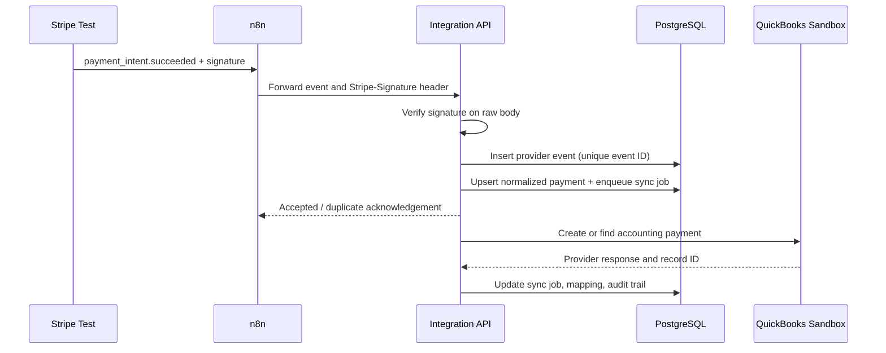

# Architecture and integration flow

## Goals

The demo models a small-business payment-to-accounting pipeline. Stripe is the payment source of truth; QuickBooks Online is the accounting destination; PostgreSQL stores an integration ledger; n8n coordinates the work.

## Logical components

1. **Stripe (test mode):** emits payment lifecycle events such as `payment_intent.succeeded`.
2. **n8n webhook workflow:** accepts the event and forwards it to the trusted integration endpoint. It is an orchestrator, not the signature-verification boundary.
3. **Integration API / Supabase Edge Function:** verifies the Stripe signature against the unmodified raw request body, validates event type and payload, deduplicates by Stripe event ID, persists the event, and schedules downstream work.
4. **Supabase PostgreSQL:** stores normalized payment records, sync jobs, provider mappings, and audit events.
5. **QuickBooks Online Sandbox:** receives the accounting-side customer/payment representation after successful validation and mapping.
6. **Operations UI (future):** displays processing state, retry history, reconciliation differences, and operator actions.

## Event flow

## Trust boundaries

- Signature verification must happen in the integration API before trusting an event. Configure the API gateway/runtime to preserve the raw body. Do not parse and re-serialize JSON before signature verification.
- n8n should call a private integration endpoint over HTTPS. Protect it with a dedicated service credential, allow-listing where practical, and rate limits.
- Keep Stripe secrets, QuickBooks client secrets, refresh tokens, and database service-role keys in a secret manager or n8n credential store. Never place them in workflow JSON or source control.
- QuickBooks OAuth tokens must be encrypted at rest and refreshed server-side. Never expose refresh tokens to a browser.
- Store only the minimum provider payload fields needed for support and reconciliation. Redact personal and financial data from logs.

## Reliability and idempotency

- Use the Stripe event ID as the unique inbound event key. A repeated delivery should return a successful duplicate acknowledgement without creating another accounting record.
- Use a stable internal payment ID and persist the QuickBooks entity ID after creation. Before retrying a create operation, check the mapping to avoid duplicate accounting entries.
- Persist the inbound event and sync job before making an external API call. Use a worker/outbox pattern so a process crash cannot lose work between database commit and API call.
- Retry transient failures (timeouts, 429, and selected 5xx responses) with exponential backoff and jitter. Do not endlessly retry validation or permission errors.
- After the retry limit, mark the job for operator review. Provide a safe replay action that reuses the same idempotency key.
- Reconcile Stripe successful payments against QuickBooks records on a schedule; surface missing, duplicated, or amount/currency-mismatched records.

## Suggested implementation sequence

1. Build and test the raw-body Stripe signature verifier.
2. Add the event ingestion endpoint and unique event persistence.
3. Normalize successful PaymentIntent events into the payments table.
4. Enqueue QuickBooks sync jobs transactionally.
5. Implement QuickBooks OAuth 2.0 against a Sandbox company and customer/payment mapping.
6. Add retry worker, reconciliation, metrics, and operations UI.

## Local development topology

Use isolated test resources. A local n8n instance can receive Stripe test webhooks through a secure development tunnel. Point the workflow at a development-only integration endpoint. Never connect this demo to a live Stripe account or production QuickBooks company.
